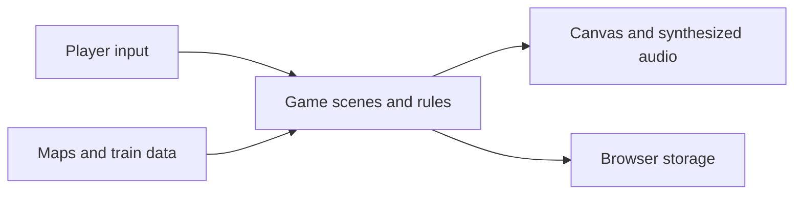

# Conducted: Copper Version

A handheld-style train-collecting adventure that runs in the browser. Choose Steamini, Sparkart or Diesling in Piston Town, cross Route 1 to Coal Harbor, battle and couple on wild trains in the tall grass and the weedy rail yards, and take the Harbor Badge from Captain Marina.

Every tile, building, character, train and effect is drawn from code into a 240x160 framebuffer, and every song is written as note text and synthesized with Web Audio. The game loads no image or audio files.

## What it does

- Explore towns and routes, battle trainers, and collect trains.
- Build a party, learn moves, evolve trains, and earn badges.
- Save progress in browser storage and play with keyboard or touch controls.

## Quick start

Run `python3 -m http.server 8765` from the repository root and open the local server in a browser. Keyboard: arrows or WASD move, Z confirms, X cancels (hold to run), and Enter opens the menu. Phones and tablets get an on-screen pad.

## How it works



`copper/src/core` holds the framebuffer, font, input, scene loop and synthesizer; `copper/src/art` the terrain, buildings, props, characters, train creatures and battle effects; `copper/src/data` the maps, species, moves, types, items and music; `copper/src/game` the overworld, battles, menus and saves; `copper/src/scripts` the story, trainers and town services. The root `index.html` and `copper/index.html` load the same scripts.

Nothing outside `main.js` touches the DOM, so the whole game runs headless in Node.

## Run and test locally

The checks in `.github/workflows/check.tests.yml` require Node 18 or newer:

```sh
for f in js/dispatch/*.js; do node --check "$f"; done
find copper/src -name '*.js' -print0 | xargs -0 -n1 node --check
npm test
```

## Configuration

No configuration or external infrastructure is required. Saves use browser local storage.

## Status

Open work is tracked in the [project goal](https://github.com/quadseven/conducted/issues/115).

## Contributing

Changes land through pull requests. The Node syntax and test checks and the leak scan must pass. Read [AGENTS.md](AGENTS.md) before contributing.

## Other games

The repository also includes Grand Transit, a train-collecting RPG at
`grand-transit.html`, and Runaway Junction, a signal-box arcade game at
`runaway.html`. Serve either with the local server in Quick start.
