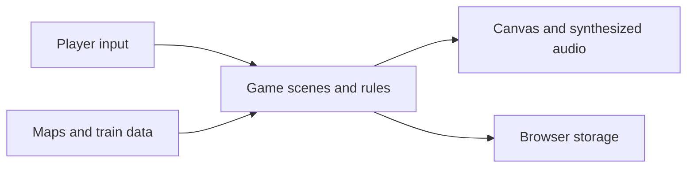

# Conducted: Copper Version

A browser adventure for players who enjoy collecting and battling trains.

Choose a starter, explore railway towns and earn badges. Procedural graphics
and synthesized music run without image or audio downloads.

## What it does

- Explore towns and routes, battle trainers, and collect trains.
- Build a party, learn moves, evolve trains, and earn badges.
- Save progress in browser storage and play with keyboard or touch controls.

## Quick start

Run `python3 -m http.server 8765` from the repository root and open the local server in a browser. Keyboard: arrows or WASD move, Z confirms, X cancels (hold to run), and Enter opens the menu. Phones and tablets get an on-screen pad.

## How it works



`copper/src/core` holds the framebuffer, font, input, scene loop and synthesizer; `copper/src/art` the terrain, buildings, props, characters, train creatures and battle effects; `copper/src/data` the maps, species, moves, types, items and music; `copper/src/game` the overworld, battles, menus and saves; `copper/src/scripts` the story, trainers and town services. The root `index.html` and `copper/index.html` load the same scripts.

Input and canvas setup use browser APIs in the core modules. Game logic can also run headlessly in Node with browser stubs.

## Run and test locally

The checks in `.github/workflows/check.tests.yml` require Node 18 or newer:

```sh
for f in js/dispatch/*.js; do node --check "$f"; done
find copper/src -name '*.js' -print0 | xargs -0 -n1 node --check
npm test
```

## Configuration

No configuration or external infrastructure is required. Saves use browser local storage.

## Status

Open work is tracked in the [project goal](https://github.com/quadseven/conducted/issues/115).

## Contributing

Changes land through pull requests. The Node syntax and test checks and the leak scan must pass. Read [AGENTS.md](AGENTS.md) before contributing.

## Other games

Serve the repository as described in Quick start to play these games.

### Grand Transit

Open `grand-transit.html` for a train-collecting RPG with eight districts,
Stationmasters and a final league. Use the arrow keys to move, Z or Enter to
confirm, X or Backspace to cancel, and Escape to open the field menu. Touch
controls provide a directional pad and A and B buttons. SAVE in the field menu
writes one browser-local save; a later save replaces it.

### Runaway Junction

Open `runaway.html` to couple to a runaway freight car and stop it. Avoid
passenger trains by setting points and closing gates. Use Up/W for power,
Down/S for brake, Space for the next points, 1 to 3 for points, A to C for
gates, R for reverse, P to pause and M to mute. Touch controls appear on the
map and below the game.

## More validation

`npm test` runs the dependency-free Node suites. It reports skipped suites and
fails if a suite fails or exceeds its two-minute limit. Use `npm test -- smoke`
to select suites by name. `node tests/dispatch-logic.test.js` runs the
Runaway Junction logic tests. The Copper smoke suite covers movement, battles
and save/load; the other suites check the rules and data behind those loops.

Three suites are skipped: `tests/menu-navigation.test.js` needs Playwright;
`tests/rival.test.js` needs a browser DOM; and `tests/rail-mart.test.js` targets
a shop path replaced by menu overlays.
