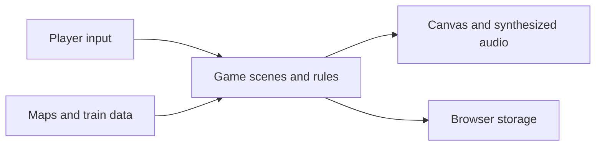

# Conducted: Copper Version

A handheld-style train-collecting adventure that runs in the browser. Choose Steamini, Sparkart or Diesling in Piston Town, cross Route 1 to Coal Harbor, battle and couple on wild trains in the tall grass and the weedy rail yards, and take the Harbor Badge from Captain Marina.

Every tile, building, character, train and effect is drawn from code into a 240x160 framebuffer, and every song is written as note text and synthesized with Web Audio. The game loads no image or audio files.

## What it does

- Explore towns and routes, battle trainers, and collect trains.
- Build a party, learn moves, evolve trains, and earn badges.
- Save progress in browser storage and play with keyboard or touch controls.

## Quick start

Run `python3 -m http.server 8765` from the repository root and open the local server in a browser. Keyboard: arrows or WASD move, Z confirms, X cancels (hold to run), and Enter opens the menu. Phones and tablets get an on-screen pad.

## How it works



`copper/src/core` holds the framebuffer, font, input, scene loop and synthesizer; `copper/src/art` the terrain, buildings, props, characters, train creatures and battle effects; `copper/src/data` the maps, species, moves, types, items and music; `copper/src/game` the overworld, battles, menus and saves; `copper/src/scripts` the story, trainers and town services. The root `index.html` and `copper/index.html` load the same scripts.

Input and canvas setup use browser APIs in the core modules. Game logic can also run headlessly in Node with browser stubs.

## Run and test locally

The checks in `.github/workflows/check.tests.yml` require Node 18 or newer:

```sh
for f in js/dispatch/*.js; do node --check "$f"; done
find copper/src -name '*.js' -print0 | xargs -0 -n1 node --check
npm test
```

## Configuration

No configuration or external infrastructure is required. Saves use browser local storage.

## Status

Open work is tracked in the [project goal](https://github.com/quadseven/conducted/issues/115).

## Contributing

Changes land through pull requests. The Node syntax and test checks and the leak scan must pass. Read [AGENTS.md](AGENTS.md) before contributing.

## Additional validation

The tests drive the game with button presses, from the title screen to the Harbor Badge:

```bash
npm test
```

## Grand Transit (earlier prototype)

The earlier Grand Transit prototype is still playable at `grand-transit.html`.

Grand Transit is a zero-dependency browser RPG about collecting, training, and battling 151 train species. The campaign spans eight railway districts, Team Derail's sabotage plot, eight Stationmasters, four Elite Conductors, and the Champion.

The game runs in an HTML5 Canvas. It uses procedural pixel art and Web Audio synthesis. It does not fetch images, music, libraries, or game data from external services.

### Start the game

Serve the repository through a local web server so browsers can load every asset consistently.

```bash
python3 -m http.server 8765
```

Open the local server's `grand-transit.html` page.

### Controls

Desktop controls:

- arrow keys move and navigate menus
- Z or Enter confirms, interacts, and advances dialogue
- X or Backspace cancels
- Escape opens the field menu

Touch devices show a directional pad and A and B buttons below the game screen.

### Campaign

Choose Steamini, Sparkart, or Diesling in Piston Town. The main line then crosses these districts:

1. Coal Harbor
2. Copper Junction
3. Ironworks
4. Verdant Platform
5. Skybeam
6. Isotope City
7. Velocity Terminal
8. Crown Central

Each district has a route, trainers, wild encounters, a city, and a Stationmaster battle. Team Derail blocks key routes during the middle chapters. Eight badges open Grand Terminus, where the Elite Conductors and Champion wait.

### Visual direction

The runtime art is drawn procedurally at a crisp 16-pixel tile scale. Each district has its own material palette, architecture, track furniture, vegetation, signs, platforms, and station details. Battles take place in an iron-and-glass terminal arena, where the eight train types use distinct creature silhouettes and every species receives deterministic body, wheel, cargo, crest, and color variation.

The surrounding interface is designed as a railway dispatch cabinet on desktop and a compact handheld control deck on mobile. No runtime artwork depends on a network request.

### Collection and progression

The game includes:

- 151 named species with stable types, stats, catch rates, experience yields, and learnsets
- eight train types and a complete 8 by 8 effectiveness chart
- 50 physical, special, and status moves
- wild encounters and four-shake Boxcar capture checks
- a persistent TrainDex for seen and caught species
- six active crew slots and persistent Depot storage
- experience, level-up moves, and evolution
- 0 to 15 individual values and Gen 1 stat experience
- shops, field items, battle items, healing depots, money, and blackout penalties

### Battle rules

Battles use the Gen 1 base damage structure, 1.5 times same-type attack bonus, a 6.25% base critical rate, and a random damage factor from 217 to 255. The engine also supports stat stages, accuracy, evasion, poison, burn, paralysis, confusion, flinching, recoil, recharge turns, fixed damage, and multi-hit moves.

Trainer AI scores move power, accuracy, same-type bonus, type effectiveness, status value, and the opponent's remaining HP. It adds a small random factor so repeated battles do not use an identical script.

### Saving

The game stores up to three save files in browser local storage. Use SAVE in the field menu to choose a slot, or SAVE FILES on the title screen to review, load, or delete a save. Replacing a valid save keeps a recovery copy; if the current file is damaged, loading tries that copy. Existing single-slot saves continue to use slot 1.

Save data includes:

- player position and current map
- party and Depot trains
- levels, moves, HP, status, IVs, and stat experience
- inventory and money
- badges and defeated trainers
- story flags and TrainDex records

## Runaway Junction

`runaway.html` is a standalone signal-box arcade game set on the same railway. A red freight car has broken loose on a yard loop and gathers speed. Drive your engine up behind it, match speed to couple gently, and brake both to a stand. Passenger trains cross the loop at three level crossings on their own timetable; close gates A, B and C to hold them at the signal, and throw points 1, 2 and 3 to steer. Points 3 can divert the runaway into a sand drag siding for a smaller bonus. Each round the runaway starts faster and the timetable tightens.

Like the main game, it has no image or audio files. Rails, sleepers, trees, roofs, trains and smoke are computed pixel by pixel into a 320 by 192 frame buffer, and the chiptune score and sound effects are composed and synthesized at run time with Web Audio.

Run it with the same local server and open `runaway.html`. Keyboard: Up/W power, Down/S brake, Space throws the next points ahead, 1 to 3 points, A to C gates, R reverse, P pause, M mute. On touch screens, tap a gate or points on the map or use the buttons.

The code lives in `js/dispatch/`: `logic.js` (track graph, switching, signals, timetable, collisions, coupling; no DOM), `art.js` (renderer), `sound.js` (composer and synthesizer) and `main.js` (loop and input). The tests run in Node:

```bash
node tests/dispatch-logic.test.js
```

## Grand Transit project structure

The main browser runtime lives in `js/`:

- `train-data.js`, `types.js`, and `moves.js` define battle data
- `npcData.js`, `world-maps.js`, and `story.js` define the campaign
- `train.js`, `player.js`, and `battle.js` implement progression and combat
- `game.js` owns the state machine and campaign orchestration
- `graphics.js` and Canvas drawing methods render the game
- `audio.js` generates music and effects through Web Audio
- `main.js` runs the 60 FPS update and render loop

The older Python files are not part of the browser build.

## Validation

Run every automated suite with one command:

```bash
npm test
```

It needs no dependencies, only the Node already on `PATH` (18 or newer), because every suite is a dependency-free Node script. Each suite runs alone in its own worker thread and the command exits non-zero if any of them fails, so a broken overworld or battle loop fails the run rather than scrolling past. A suite that hangs is dropped after two minutes rather than blocking the rest of the run.

The runner reports each suite, the total passed and failed, and any suites it skips.

Pass a substring to run part of the suite, for example `npm test -- smoke`.

`copper/tests/smoke.test.js` is the smoke suite. It plays the two loops a session spends all its time in, end to end and through real button presses: entering a building and coming back out, crossing a map connection and crossing it back, winning a battle, losing a battle and waking up at the last depot, and saving then loading a game. The rest of the suites check the rules underneath those loops in more detail -- damage and types in `battle.test.js`, map and warp integrity in `world.test.js`, save-slot handling in `save.test.js` -- and the `tests/` suites cover the data and the earlier browser build in `js/`.

`tests/test-runner-integrity.test.js` guards the runner itself: that it only ever collects suites out of the two suite directories, that every suite it leaves out comes with a reason, and that it never assembles a command line to run one. The last one is a code-scanning rule (CWE-78) rather than a bug we hit, and the test keeps the flag from coming back.

`tests/error-page-escaping.test.js` guards `error-test.html`, the debug page that mirrors window errors and console output into the DOM, and `js/error-capture.js`, the module that does the capturing for it. It drives that module against a stub DOM and checks the captured text is shown as text: an error message or a logged value is runtime input, and pasting it into `innerHTML` would run any markup in it (CWE-79, reported by code scanning as cross-site scripting). The page and the test load the one module rather than the test running the page's markup, so the page cannot break behind a passing test.

A few suites cannot run headlessly and are reported as skipped at the end of every run, with the reason, so the gap stays visible: `tests/menu-navigation.test.js` needs Playwright, and `tests/rival.test.js` and `tests/rail-mart.test.js` build the browser runtime in `js/` or drive shop code that the menu overlays have since replaced.

CI runs `npm test` on every pull request (`.github/workflows/check.tests.yml`).

The core integrity test verifies species and move counts, unique names, learnsets, types, matchups, NPC rosters, campaign map counts, warp destinations, warp coordinates, EV serialization, Depot serialization, and old-save map migration.

## Original work

Grand Transit uses an original railway setting, train species, names, story, graphics, sounds, maps, and dialogue. Its turn-based collection structure draws inspiration from handheld monster-training RPGs.
